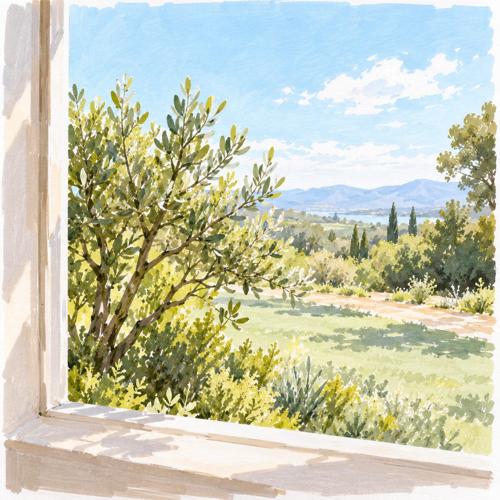
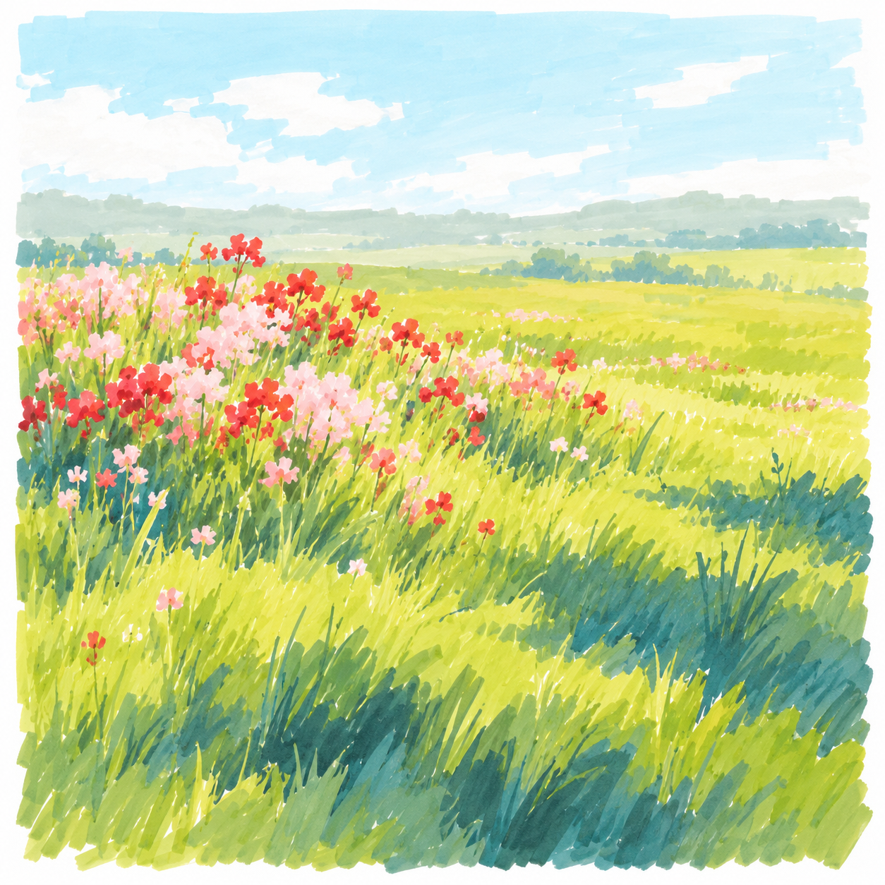
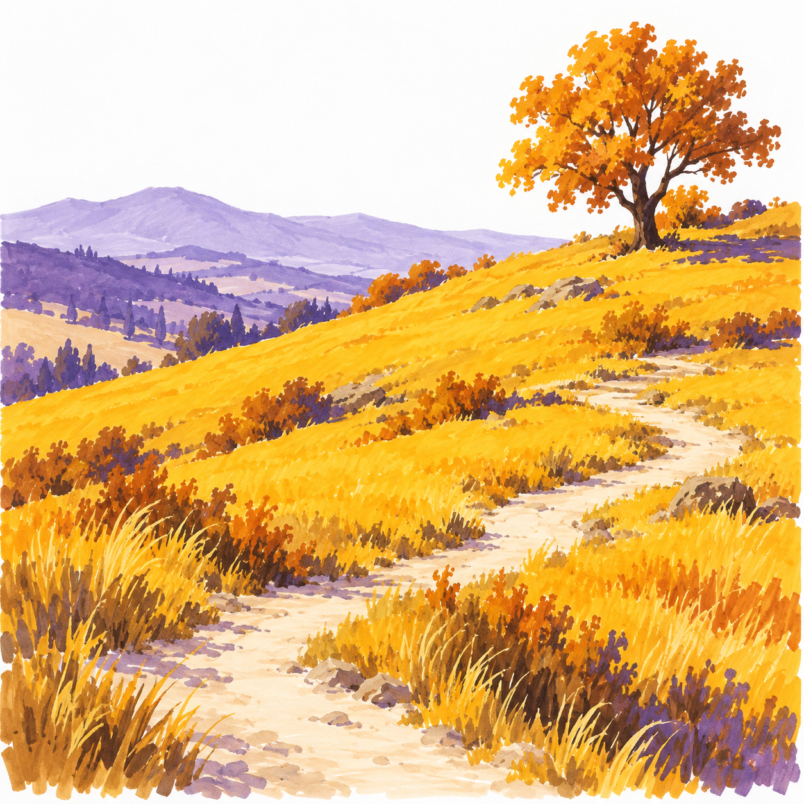
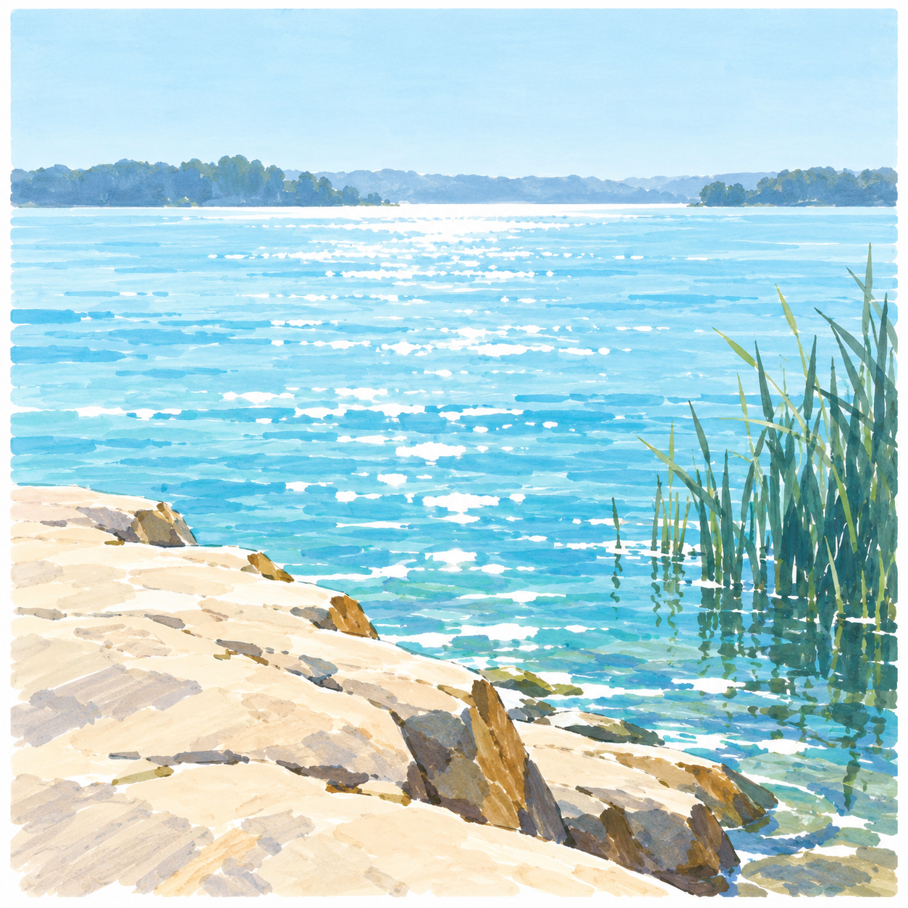
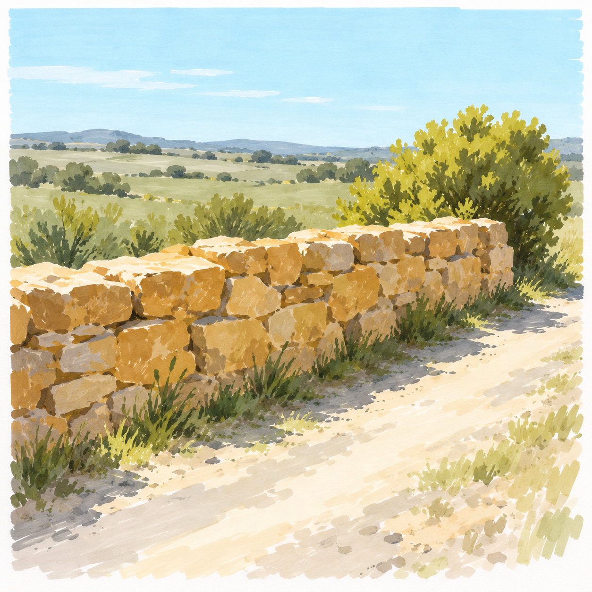
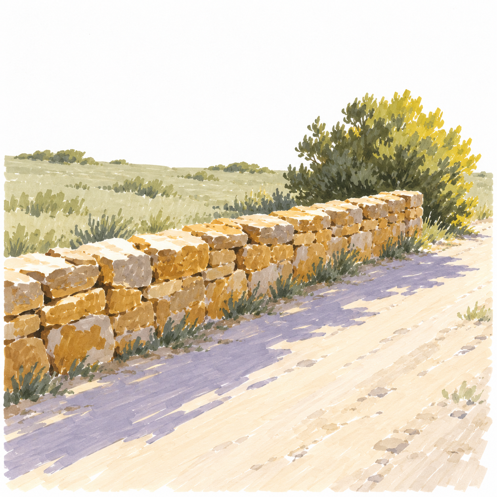
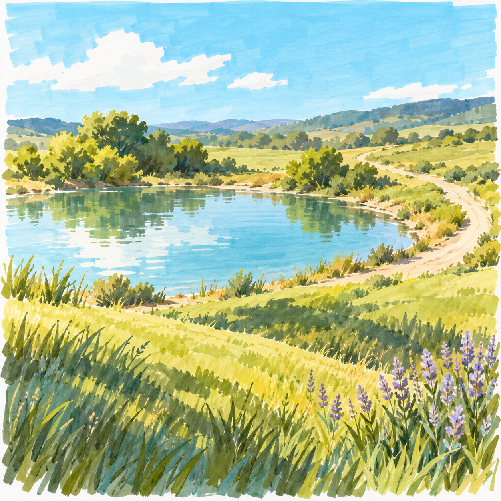

# D4 自主创作｜S002七课

[返回整体节奏](README.md) · [本阶段正文入口](../../../lessons/independent/S002-README.md)

| 序位 | 完整教案 | 主要目标 | 本幅作用 |
| --- | --- | --- | --- |
| 1 | [S002-026 窗外的第一束晴光](../../../lessons/independent/050-morning-window-view.md) | 自主选择取景范围与主要色块 | 建立技能 |
| 2 | [S002-027 夏天的一块草地](../../../lessons/independent/051-summer-meadow-design.md) | 自主决定疏密与主色分工 | 建立技能 |
| 3 | [S002-028 赭黄山坡的晴天](../../../lessons/independent/052-autumn-slope-design.md) | 迁移同一风格到暖色季节配色 | 换题迁移 |
| 4 | [S002-029 清蓝岸边的一天](../../../lessons/independent/053-cool-shore-design.md) | 在冷色主调中自主保留阳光感 | 换题迁移 |
| 5 | [S002-030 同一角落·正午](../../../lessons/independent/054-same-place-noon.md) | 为小系列建立一致取景与物件关系 | 巩固组合 |
| 6 | [S002-031 同一角落·午后](../../../lessons/independent/055-same-place-late.md) | 同构图中自主改变光色与投影 | 巩固组合 |
| 7 | [S002-032 我想留下的晴日](../../../lessons/independent/056-own-sunny-place.md) | 独立完成主题、构图与取舍并复盘 | 阶段回看 |

## 1. 窗外的第一束晴光

自主选择取景范围与主要色块。

完成自主小稿后展开AI解法示意

[进入详细正文](../../../lessons/independent/050-morning-window-view.md)

## 2. 夏天的一块草地

自主决定疏密与主色分工。

完成自主小稿后展开AI解法示意

[进入详细正文](../../../lessons/independent/051-summer-meadow-design.md)

## 3. 赭黄山坡的晴天

迁移同一风格到暖色季节配色。

完成自主小稿后展开AI解法示意

[进入详细正文](../../../lessons/independent/052-autumn-slope-design.md)

## 4. 清蓝岸边的一天

在冷色主调中自主保留阳光感。

完成自主小稿后展开AI解法示意

[进入详细正文](../../../lessons/independent/053-cool-shore-design.md)

## 5. 同一角落·正午

为小系列建立一致取景与物件关系。

完成自主小稿后展开AI解法示意

[进入详细正文](../../../lessons/independent/054-same-place-noon.md)

## 6. 同一角落·午后

同构图中自主改变光色与投影。

完成自主小稿后展开AI解法示意

[进入详细正文](../../../lessons/independent/055-same-place-late.md)

## 7. 我想留下的晴日

独立完成主题、构图与取舍并复盘。

完成自主小稿后展开AI解法示意

[进入详细正文](../../../lessons/independent/056-own-sunny-place.md)
