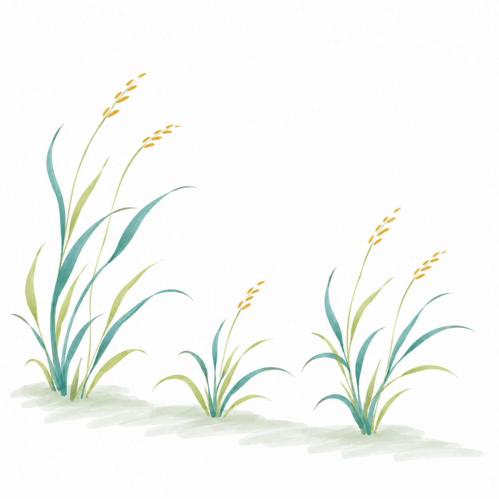
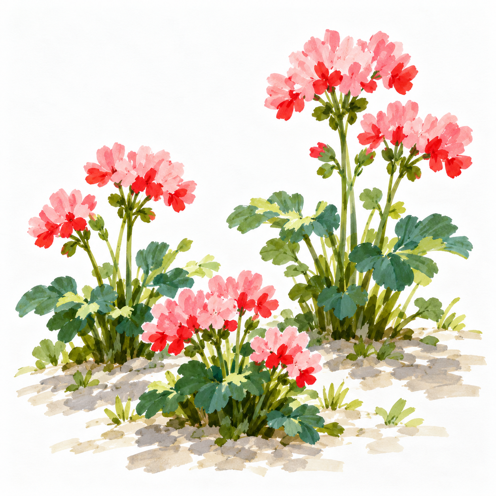
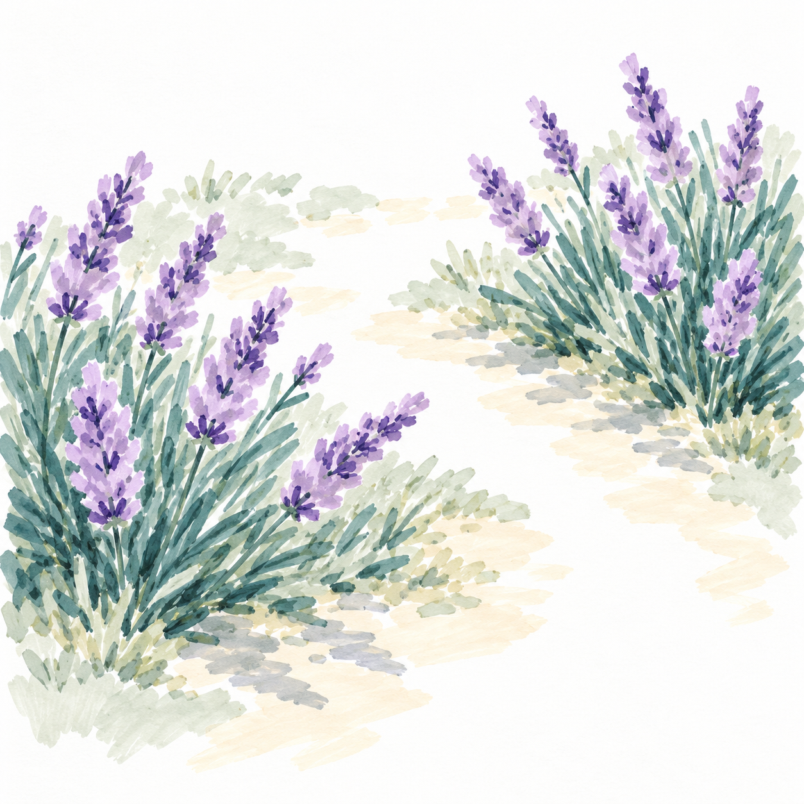
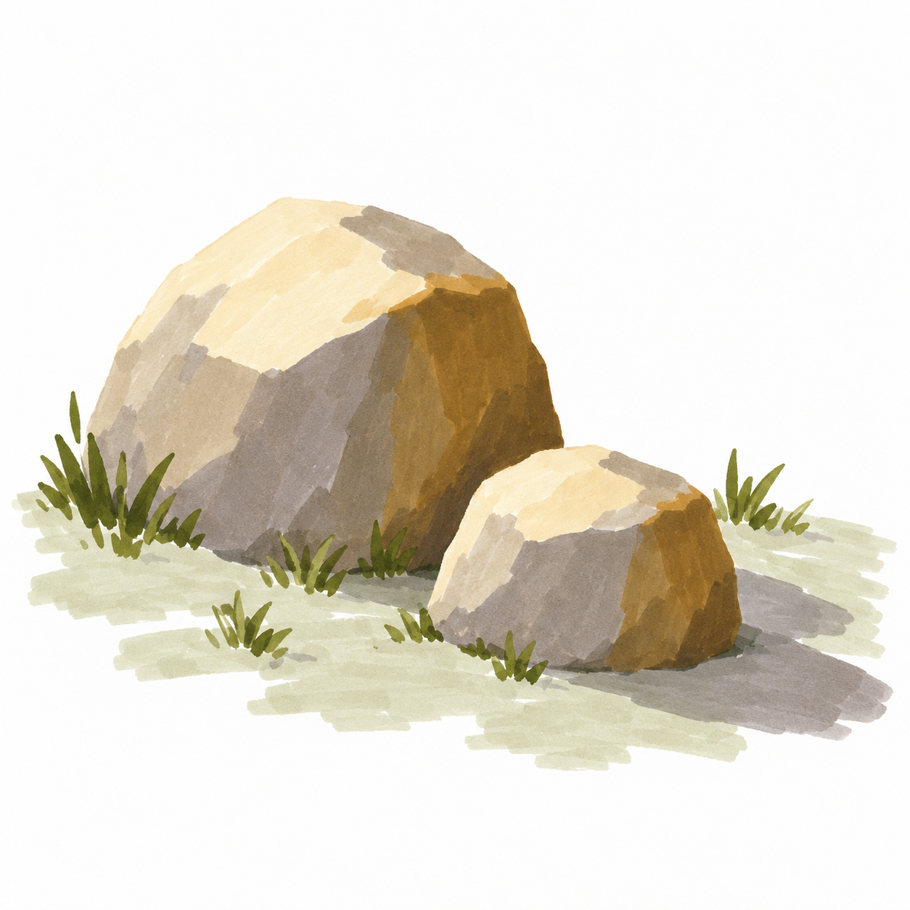
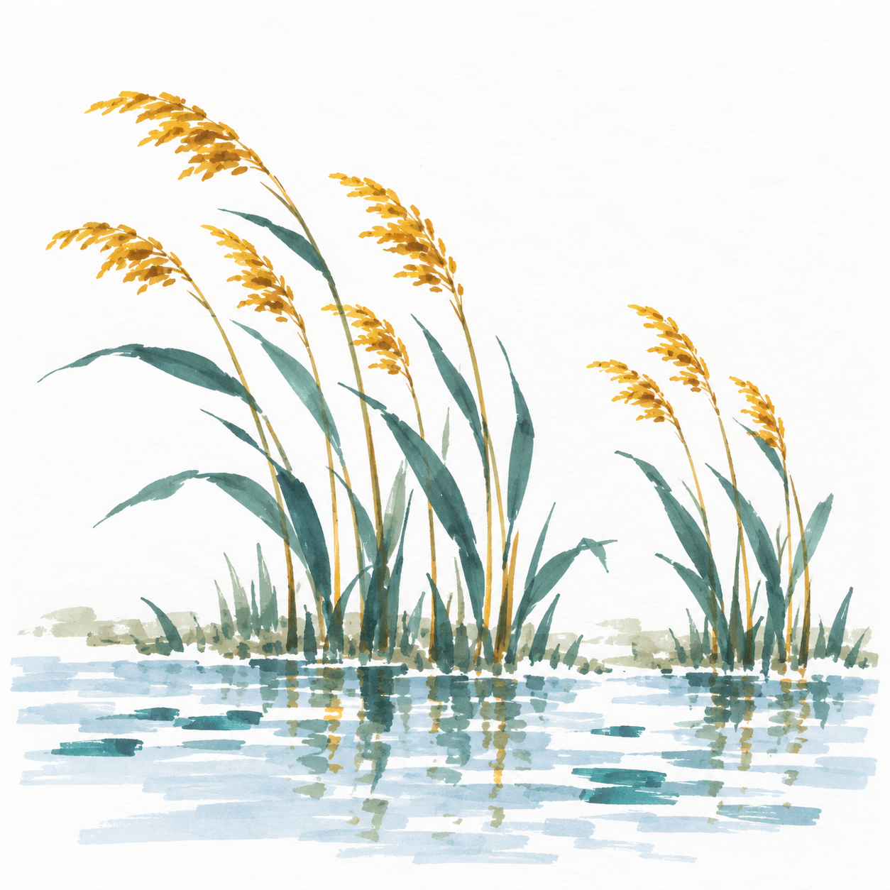
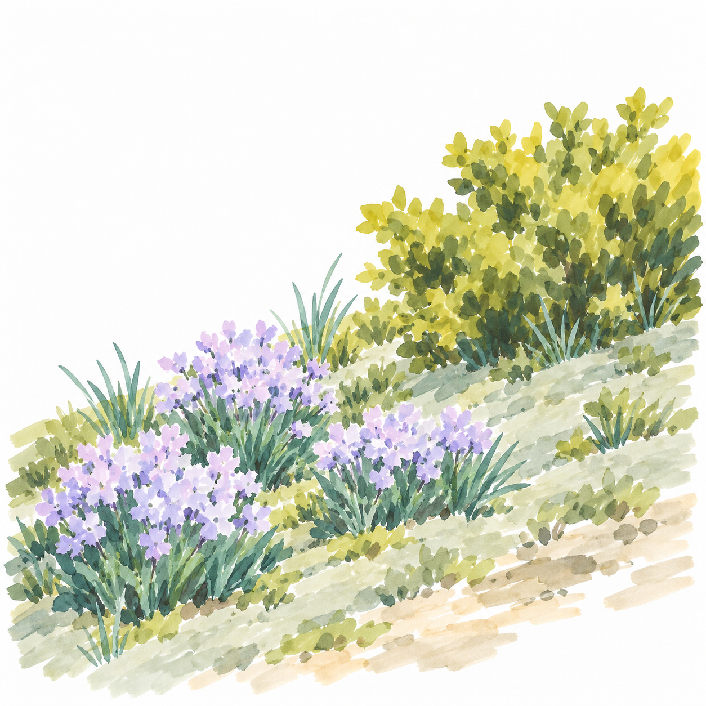

# D2 专项控制｜S002七课

[返回整体节奏](README.md) · [本阶段正文入口](../../../lessons/intermediate/S002-README.md)

| 序位 | 完整教案 | 主要目标 | 本幅作用 |
| --- | --- | --- | --- |
| 1 | [S002-012 枝头的叶影](../../../lessons/intermediate/036-leaf-clusters.md) | 用同向短笔触组成疏密有别的叶簇 | 建立技能 |
| 2 | [S002-013 坡脚的长短草](../../../lessons/intermediate/037-grass-rhythm.md) | 控制长短笔触与疏密节奏 | 建立技能 |
| 3 | [S002-014 红花向着光](../../../lessons/intermediate/038-red-flower-transfer.md) | 把叶簇笔触迁移到花丛并保留亮部 | 换题迁移 |
| 4 | [S002-015 薰衣草的小空隙](../../../lessons/intermediate/039-lavender-banks.md) | 用笔触密度表现成团植物并留通气空隙 | 换题迁移 |
| 5 | [S002-016 两块石头的午后](../../../lessons/intermediate/040-stone-shadow-transfer.md) | 在两个物体上保持一致光向和明暗分组 | 巩固组合 |
| 6 | [S002-017 一小片芦苇](../../../lessons/intermediate/041-reed-patch.md) | 组合长叶与短穗笔触并控制留白 | 巩固组合 |
| 7 | [S002-018 两种笔触的小花坡](../../../lessons/intermediate/042-shrub-review.md) | 回看叶簇与草叶笔触能否清楚分组 | 阶段回看 |

## 1. 枝头的叶影

用同向短笔触组成疏密有别的叶簇。

[进入详细正文](../../../lessons/intermediate/036-leaf-clusters.md)

## 2. 坡脚的长短草

控制长短笔触与疏密节奏。

[进入详细正文](../../../lessons/intermediate/037-grass-rhythm.md)

## 3. 红花向着光

把叶簇笔触迁移到花丛并保留亮部。

[进入详细正文](../../../lessons/intermediate/038-red-flower-transfer.md)

## 4. 薰衣草的小空隙

用笔触密度表现成团植物并留通气空隙。

[进入详细正文](../../../lessons/intermediate/039-lavender-banks.md)

## 5. 两块石头的午后

在两个物体上保持一致光向和明暗分组。

[进入详细正文](../../../lessons/intermediate/040-stone-shadow-transfer.md)

## 6. 一小片芦苇

组合长叶与短穗笔触并控制留白。

[进入详细正文](../../../lessons/intermediate/041-reed-patch.md)

## 7. 两种笔触的小花坡

回看叶簇与草叶笔触能否清楚分组。

[进入详细正文](../../../lessons/intermediate/042-shrub-review.md)
