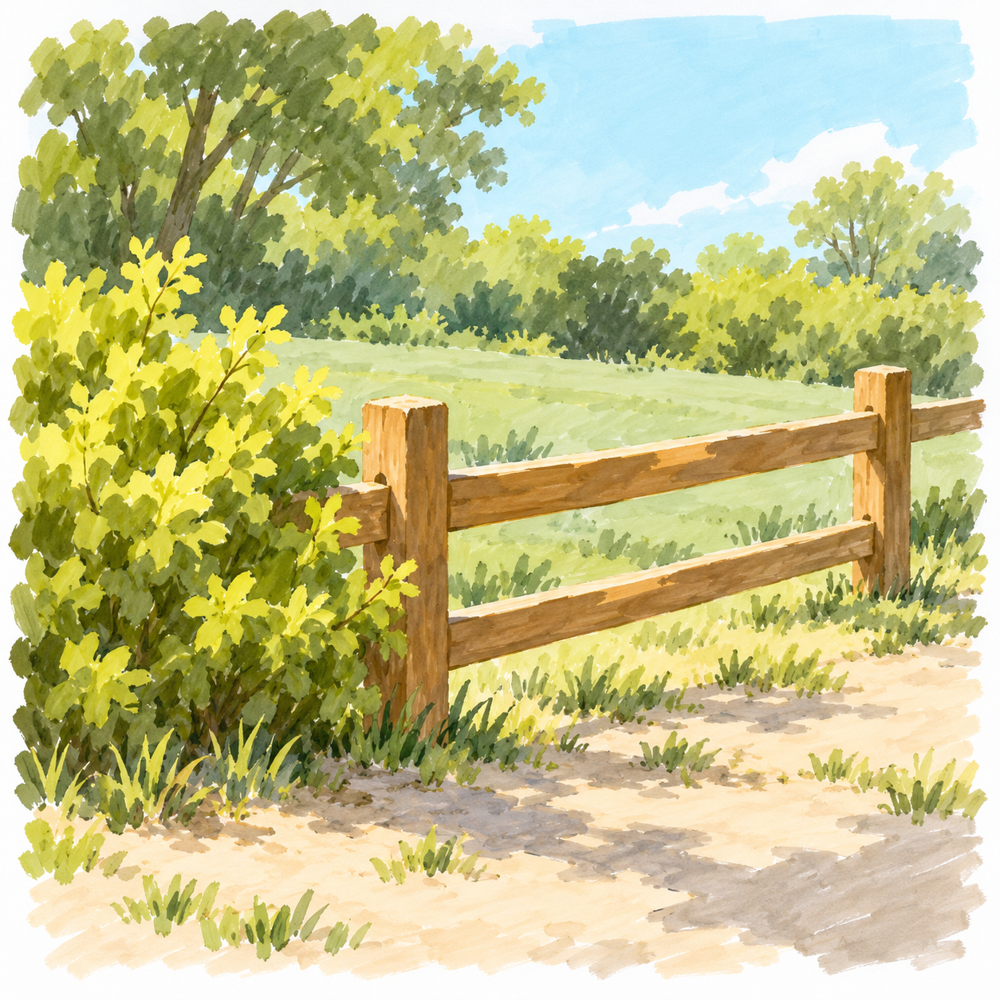
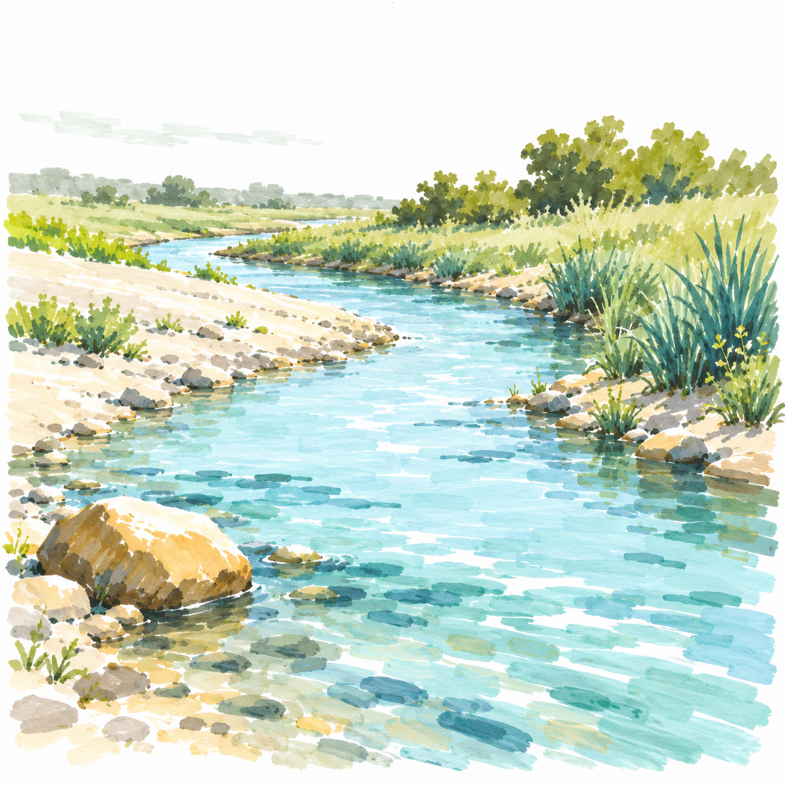
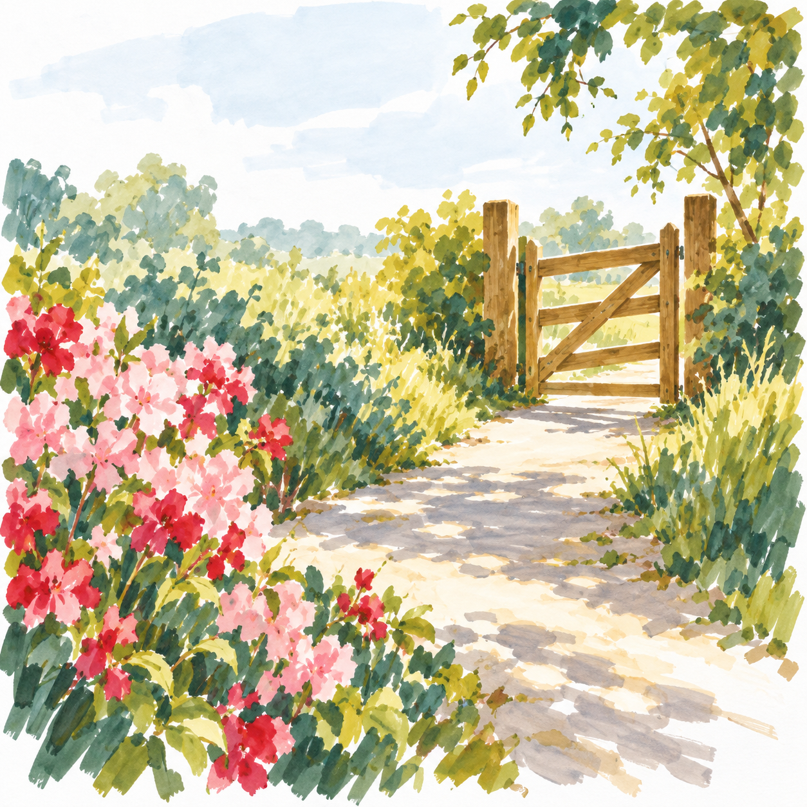
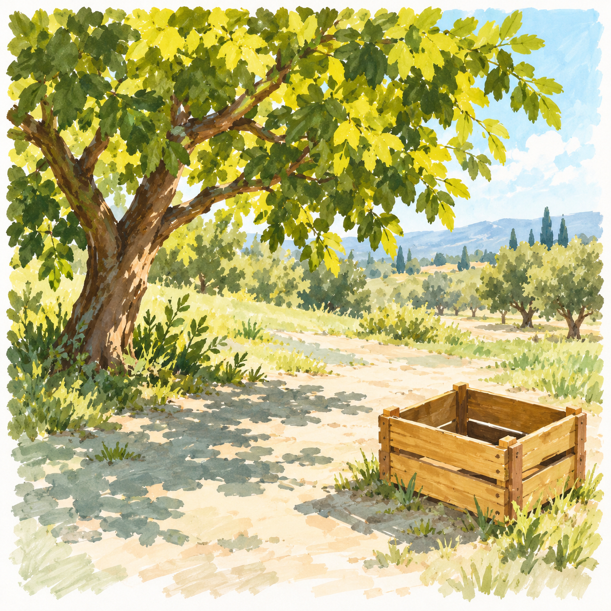
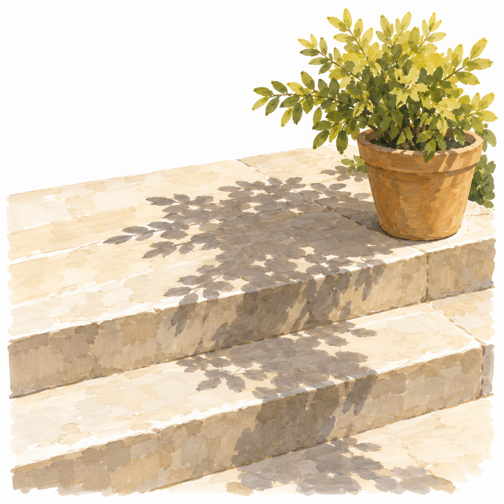
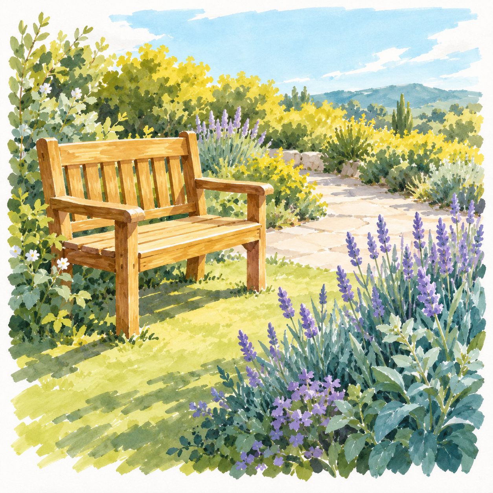

# D3 综合组织｜S002七课

[返回整体节奏](README.md) · [本阶段正文入口](../../../lessons/scene/S002-README.md)

| 序位 | 完整教案 | 主要目标 | 本幅作用 |
| --- | --- | --- | --- |
| 1 | [S002-019 木栅栏边的晴光](../../../lessons/scene/043-fence-corner.md) | 用前后遮挡建立三层小景 | 建立技能 |
| 2 | [S002-020 小溪拐了个弯](../../../lessons/scene/044-stream-turn.md) | 用近宽远窄的水面组织纵深 | 建立技能 |
| 3 | [S002-021 花丛后的园门](../../../lessons/scene/045-gate-through-flowers.md) | 安排一个焦点并降低次要细节 | 换题迁移 |
| 4 | [S002-022 果园里的空木箱](../../../lessons/scene/046-orchard-rest.md) | 协调植物大形与箱体结构 | 换题迁移 |
| 5 | [S002-023 台阶上的树影](../../../lessons/scene/047-steps-and-shadow.md) | 统一地面转折与投影关系 | 巩固组合 |
| 6 | [S002-024 金色田边的转弯](../../../lessons/scene/048-field-edge.md) | 用近密远疏安排空间与节奏 | 巩固组合 |
| 7 | [S002-025 晴日花园一角](../../../lessons/scene/049-garden-review.md) | 回看焦点、三层空间与统一光向 | 阶段回看 |

## 1. 木栅栏边的晴光

用前后遮挡建立三层小景。

[进入详细正文](../../../lessons/scene/043-fence-corner.md)

## 2. 小溪拐了个弯

用近宽远窄的水面组织纵深。

[进入详细正文](../../../lessons/scene/044-stream-turn.md)

## 3. 花丛后的园门

安排一个焦点并降低次要细节。

[进入详细正文](../../../lessons/scene/045-gate-through-flowers.md)

## 4. 果园里的空木箱

协调植物大形与箱体结构。

[进入详细正文](../../../lessons/scene/046-orchard-rest.md)

## 5. 台阶上的树影

统一地面转折与投影关系。

[进入详细正文](../../../lessons/scene/047-steps-and-shadow.md)

## 6. 金色田边的转弯

用近密远疏安排空间与节奏。

[进入详细正文](../../../lessons/scene/048-field-edge.md)

## 7. 晴日花园一角

回看焦点、三层空间与统一光向。

[进入详细正文](../../../lessons/scene/049-garden-review.md)
