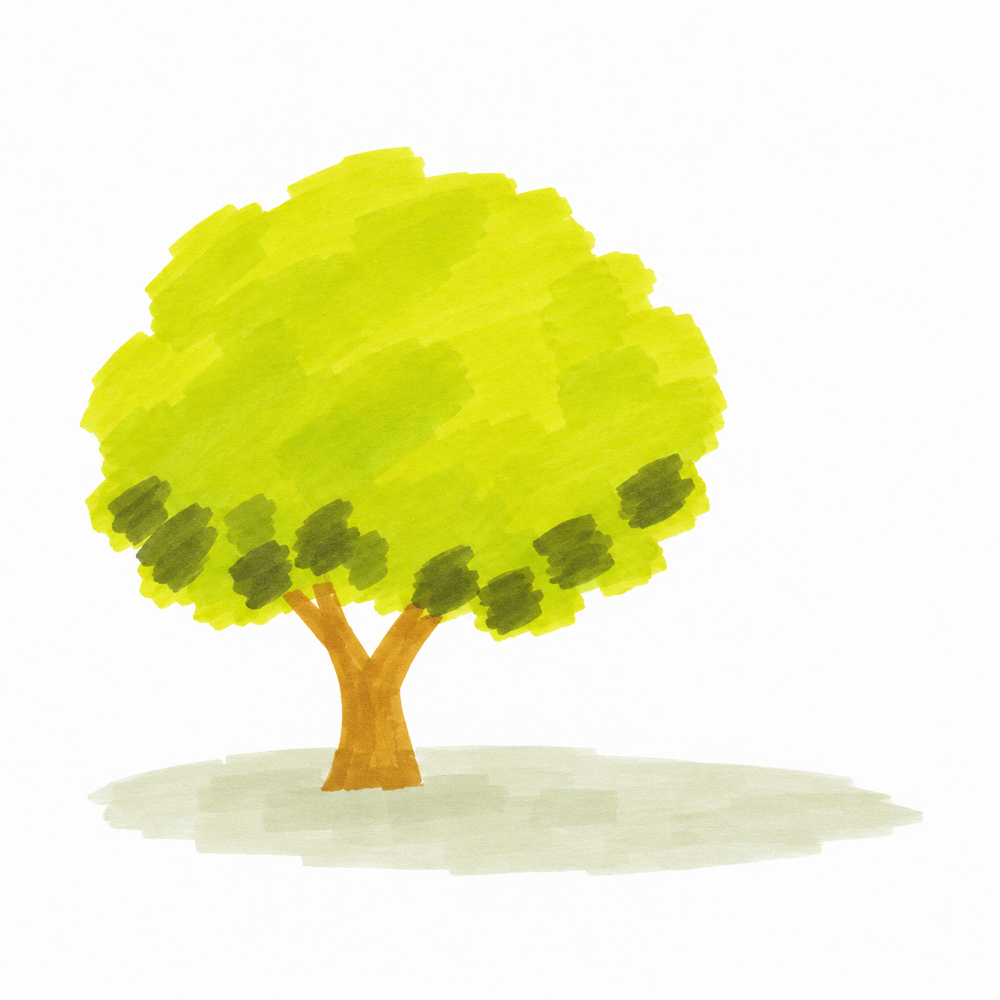
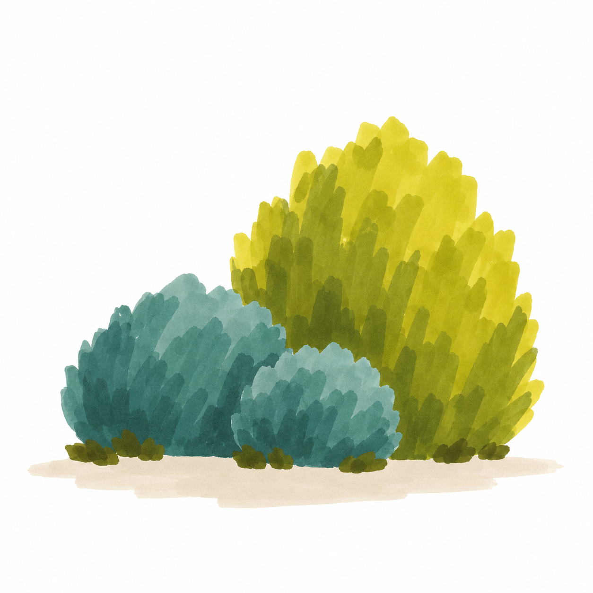
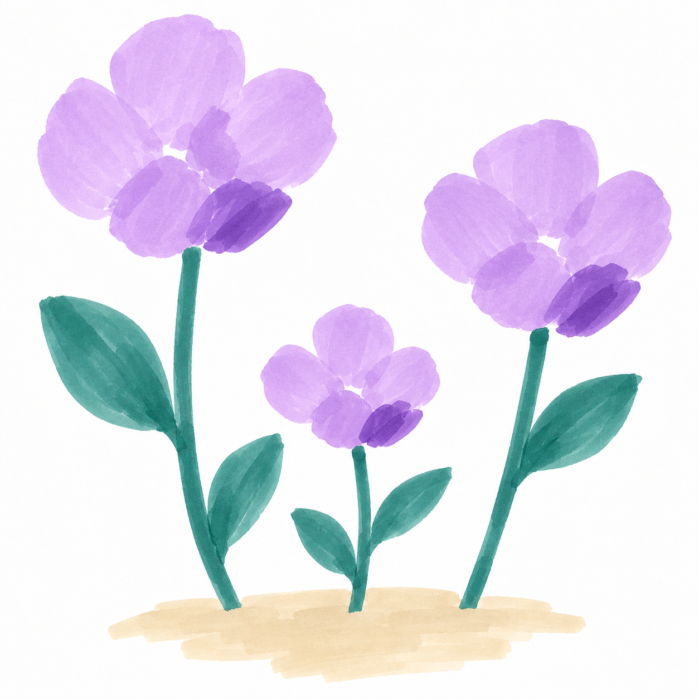
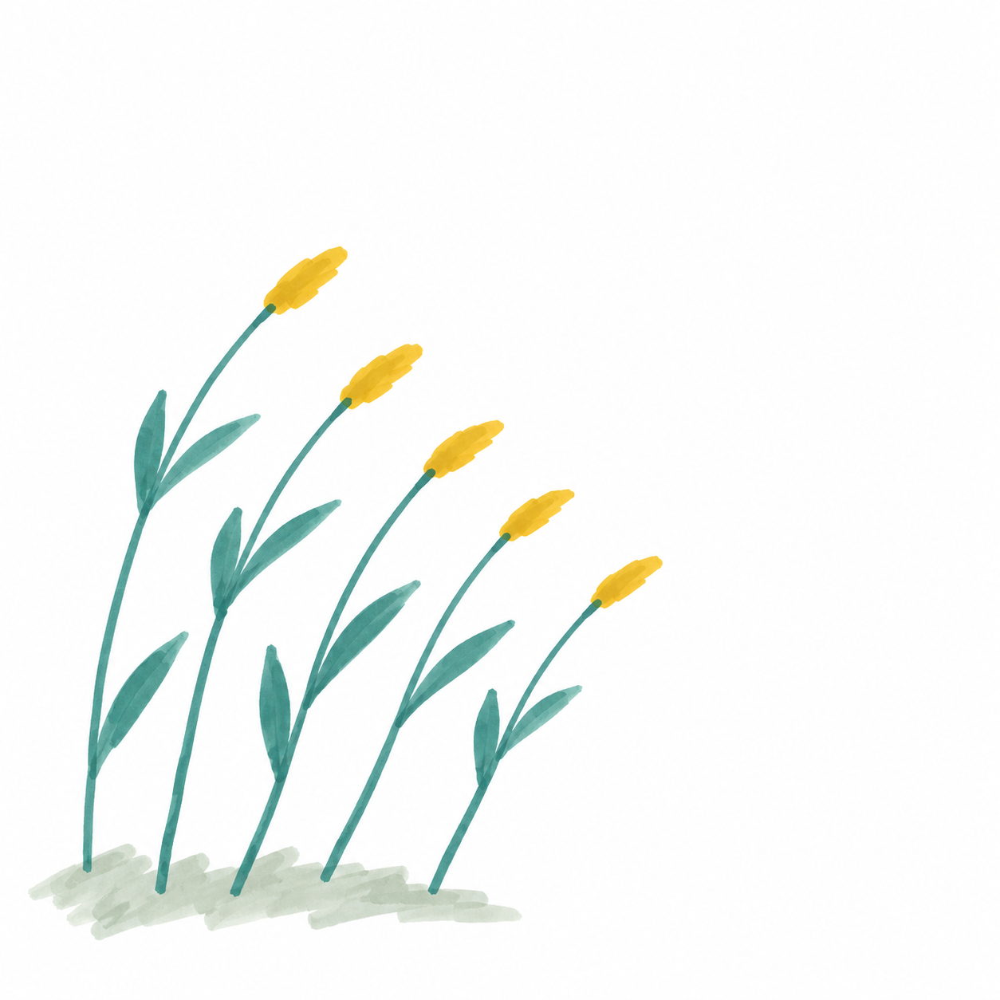
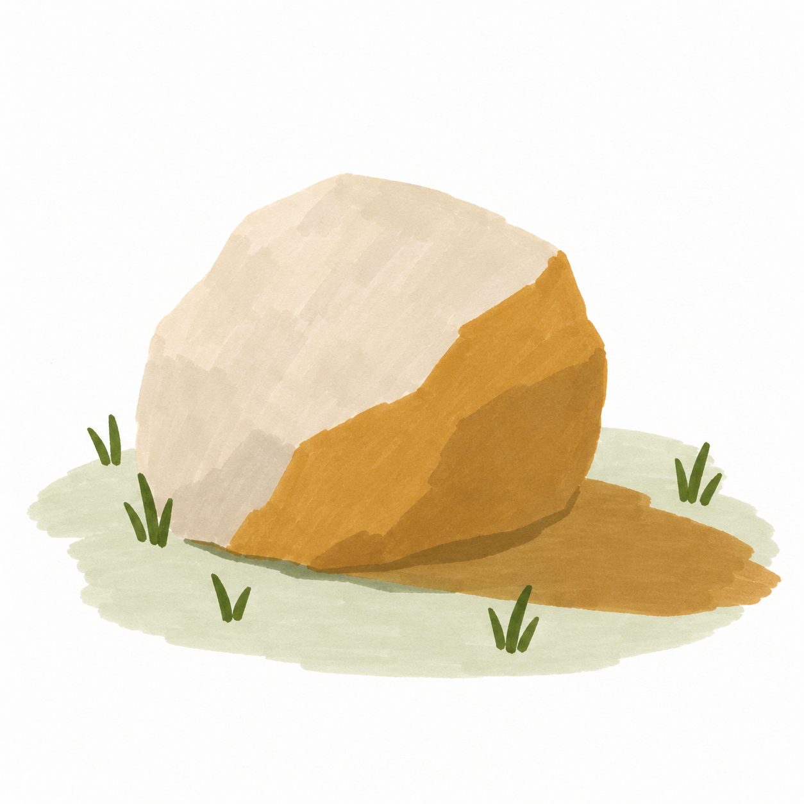

# S002 晴日笔触风景｜D1七幅完整跟画

[风格档案](../../002-sunlit-brushstroke-landscape.md) · [课程总览](../../../lessons/beginner/S002-README.md)

AI教学示意，非真实手绘。每课一个主要目标，约25～40分钟；可在铺色后暂停，干透后继续。配色按现有实涂色卡的相对色系设计，不是精确色度或实笔完成验证。

## 1. S002-005 晴光里的圆树

[完整教案](../../../lessons/beginner/029-sunny-round-tree.md) · 用树冠与树干两个大形定位主体

## 2. S002-006 白云经过草坡

[完整教案](../../../lessons/beginner/030-cloud-over-grass.md) · 在天空色块中提前保留完整白云

## 3. S002-007 路边三团灌木

[完整教案](../../../lessons/beginner/031-three-sunny-shrubs.md) · 用大小与前后遮挡组织植物大形

## 4. S002-008 晴日三枝紫花

[完整教案](../../../lessons/beginner/032-three-purple-flowers.md) · 把花头概括为大色团并保留间隙

## 5. S002-009 风往右边吹

[完整教案](../../../lessons/beginner/033-five-windy-grasses.md) · 用一致方向的长短笔触表现草叶

## 6. S002-010 草地上的暖石头

[完整教案](../../../lessons/beginner/034-sunlit-ochre-stone.md) · 用两块平涂区分受光面与暗面

## 7. S002-011 小路通向晴光

[完整教案](../../../lessons/beginner/035-path-to-sunny-shrub.md) · 回看大形、留白与简单遮挡的组合
